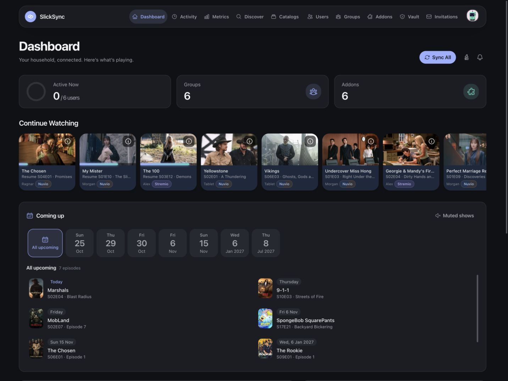
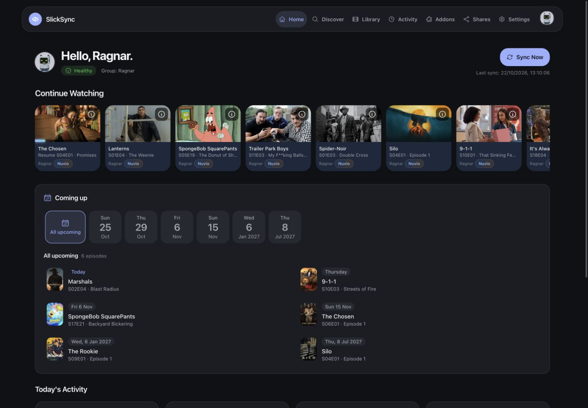
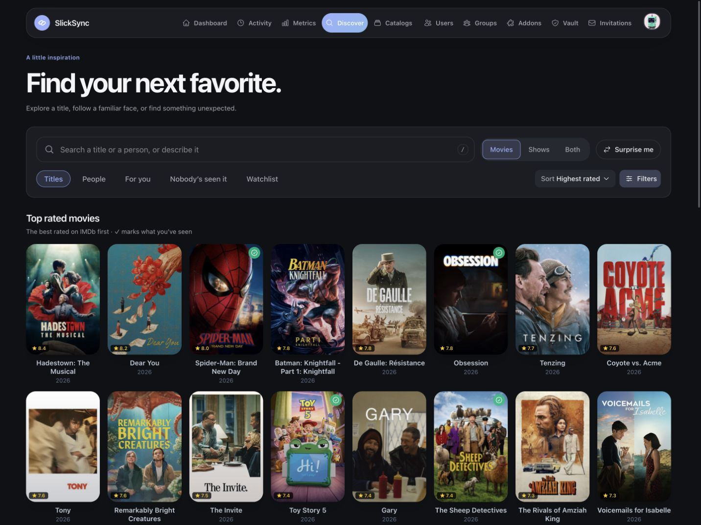
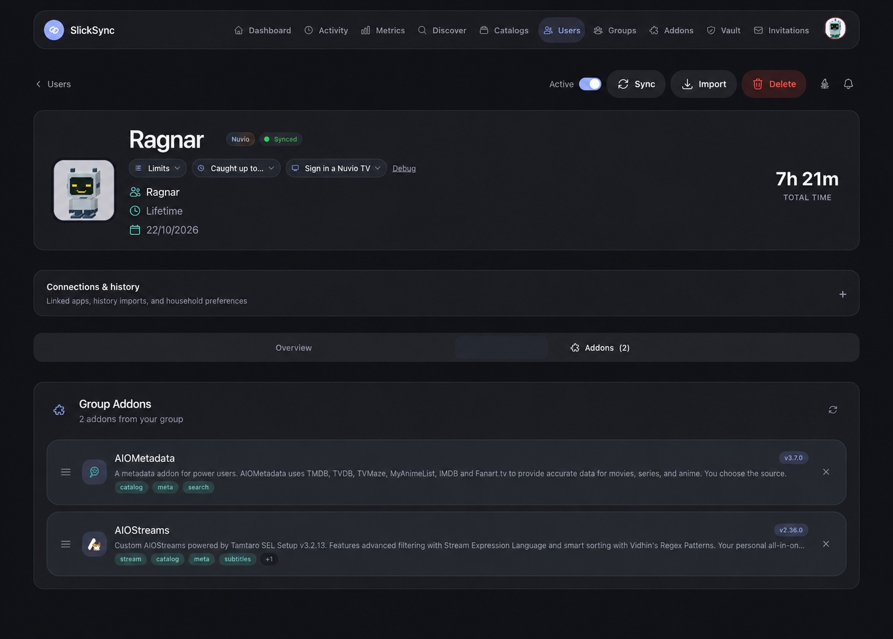

<div align="center">
  

  <h1>SlickSync</h1>

  <p>
    <a href="https://discord.gg/Q3ZhdRJ"></a>
    <a href="https://github.com/RagnarLothbrok-Odin/slicksync/stargazers"></a>
    <a href="https://github.com/RagnarLothbrok-Odin/slicksync/network/members"></a>
    <a href="https://github.com/RagnarLothbrok-Odin/slicksync/issues"></a>
    <a href="LICENSE"></a>
    <br>
    <a href="https://bun.sh/"></a>
    <a href="https://nextjs.org/"></a>
  </p>

  <p><em>Your media. Your people. All in sync.</em></p>
</div>

---

## 🌟 About the Project

SlickSync is a self-hosted control panel for Nuvio and Stremio, with Jellyfin, AIOStreams and AIOMetadata integrations. Manage shared addons and collections, follow viewing activity, and give each person their own library and dashboard.

Run it for a household with SQLite or host independent accounts with PostgreSQL.

## ✨ Features

<table>
  <tr>
    <td width="50%">
      <h3>🔄 Shared Addons</h3>
      <p>Organize users into groups and keep their addon configurations in sync.</p>
    </td>
    <td width="50%">
      <h3>🗂️ Collections & Catalogs</h3>
      <p>Arrange Nuvio collections and home rows, and manage Jellyfin and AIOStreams catalogs.</p>
    </td>
  </tr>
  <tr>
    <td width="50%">
      <h3>🎬 Discover & Resume</h3>
      <p>Browse rated movies and shows, pick up where you left off, and see upcoming episodes.</p>
    </td>
    <td width="50%">
      <h3>📊 Activity & Insights</h3>
      <p>See recent viewing, live playback where supported, watch history and household statistics.</p>
    </td>
  </tr>
  <tr>
    <td width="50%">
      <h3>👤 Personal Dashboards</h3>
      <p>Give people their own library, activity, profile selection and display preferences.</p>
    </td>
    <td width="50%">
      <h3>🔐 Vault & Backups</h3>
      <p>Manage encrypted provider credentials, shared access and backups from one place.</p>
    </td>
  </tr>
</table>

## 📸 Screenshots

Captured from the running app. Other names are replaced with demo names and email addresses are hidden.

<table>
  <tr>
    <td align="center" width="50%">
      <strong>Admin Dashboard</strong><br>
      <a href="docs/screenshots/admin-dashboard.jpg"></a>
    </td>
    <td align="center" width="50%">
      <strong>Personal Home</strong><br>
      <a href="docs/screenshots/personal-home.jpg"></a>
    </td>
  </tr>
  <tr>
    <td align="center" width="50%">
      <strong>Discover</strong><br>
      <a href="docs/screenshots/discover.jpg"></a>
    </td>
    <td align="center" width="50%">
      <strong>User Addons</strong><br>
      <a href="docs/screenshots/user-addons.jpg"></a>
    </td>
  </tr>
</table>

## 🚀 Requirements

- Docker with Docker Compose for deployment.
- A reverse proxy providing HTTPS when exposing the app beyond localhost.
- [Bun](https://bun.sh/) for local development.

## 🛠️ Setup

1. Clone the fork and copy the environment template:

   ```sh
   git clone https://github.com/RagnarLothbrok-Odin/slicksync.git
   cd slicksync
   cp .env.example .env
   ```

2. Choose a deployment mode and set its values in `.env`:

   | Mode | Database | Required configuration |
   |---|---|---|
   | **Private**: one household | SQLite | `JWT_SECRET`, `SLICKSYNC_PRIVATE_USERNAME`, `SLICKSYNC_PRIVATE_PASSWORD` |
   | **Public**: independent accounts | PostgreSQL | `JWT_SECRET`, `ENCRYPTION_KEY`, `POSTGRES_PASSWORD` |

   Generate independent secrets with `openssl rand -base64 32`. For `POSTGRES_PASSWORD`, use `openssl rand -hex 32` so it is safe inside the database URL.

3. Start your chosen mode:

   ```sh
   # Private
   docker compose -f docker-compose.private.yml up -d

   # Or public
   docker compose -f docker-compose.public.yml up -d
   ```

4. Open [localhost:3000](http://localhost:3000). Connect your providers, then organize your users, groups and addons. The in-app **Guides** explain individual features.

> [!IMPORTANT]
> Private mode needs the username and password above unless an authentication proxy protects the entire app. Keep your data volumes and encryption key when updating.

Images are published to `ghcr.io/ragnarlothbrok-odin/slicksync` for AMD64 and ARM64. Use `:private` or `:public`, or pin a release such as `:private-v1.102.0` once that version is published. For local image builds and update instructions, see [DOCKER.md](DOCKER.md).

## 🧪 Development

Follow the [local setup guide](docs/development.md#local-setup), then use:

```sh
bun run dev          # Start frontend and backend
bun run lint         # Check TypeScript and Biome
bun run test         # Run the test suite
bun run build        # Build the frontend for production
```

## 📚 Documentation

- [Docker deployment](DOCKER.md): both modes, persistent data and updates.
- [Environment options](.env.example): configuration reference.
- [External API](API.md): integration endpoints; interactive docs at `/api/docs`.
- [Development](docs/development.md): local setup, tooling and checks.
- [Changelog & releases](CHANGELOG.md): version history and image publishing.

## 🤝 Contributing

Issues and pull requests are welcome in **this fork**. Keep changes focused, run the relevant checks, and use the repository's [issue](https://github.com/RagnarLothbrok-Odin/slicksync/issues/new/choose) and [pull request](.github/PULL_REQUEST_TEMPLATE.md) templates.

## 📜 License & Credits

Licensed under [MIT](LICENSE). Based on [SlickSync by slicknsliding](https://github.com/slicknsliding/slicksync), originally forked from [Syncio by neur0](https://github.com/iamneur0/syncio). Vault concepts credit [AIOManager](https://github.com/Sonicx161/AIOManager). See [upstream credits](README.upstream.md) for the project lineage.

---

<div align="center">
  <a href="https://github.com/RagnarLothbrok-Odin/slicksync/issues/new/choose">🐛 Report a bug</a> · <a href="https://github.com/RagnarLothbrok-Odin/slicksync/issues/new/choose">💡 Suggest an improvement</a> · <a href="#top">🔝 Back to Top</a>
</div>
